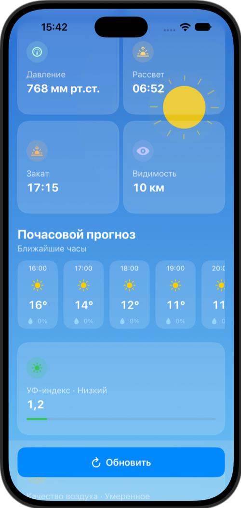
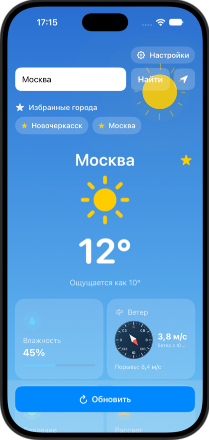
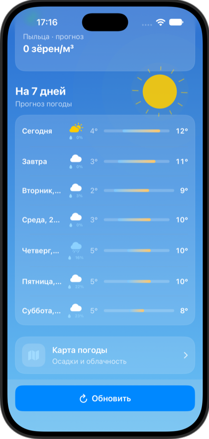
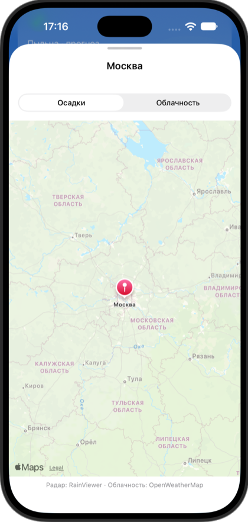
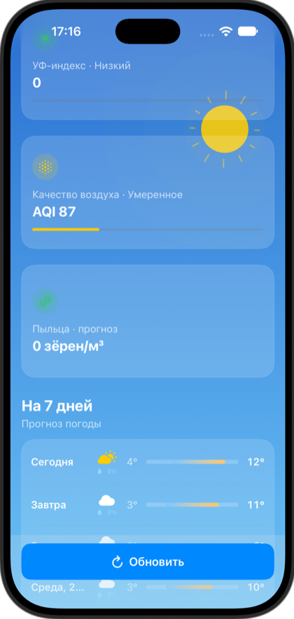
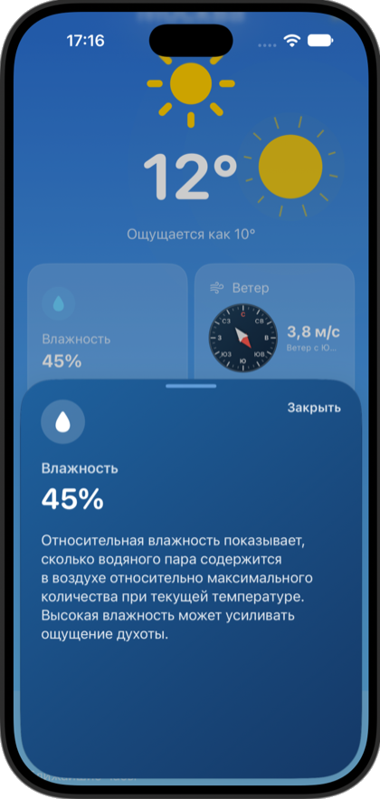
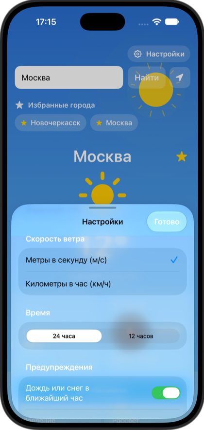

# WeatherApp

Приложение прогноза погоды для iOS 17+, созданное на SwiftUI.

## Возможности

- Поиск городов с автоподсказками и определение местоположения.
- Текущая погода: температура, ощущаемая температура, влажность, ветер с компасом и порывами.
- Давление, рассвет и закат, видимость.
- Почасовой прогноз и прогноз на 7 дней с вероятностью осадков.
- УФ-индекс, качество воздуха, PM2.5/PM10 и прогноз пыльцы.
- Избранные города с сохранением на устройстве.
- Настройки единиц измерения и формата времени.
- Локальные уведомления о дожде или снеге.
- Карта осадков и облачности.
- Виджет погоды для главного экрана.

<table>
  <tr>
    <td align="center" bgcolor="#0b1f33"> Показатели и почасовой прогноз</td>
    <td align="center" bgcolor="#0b1f33"> Главный экран и избранные города</td>
  </tr>
  <tr>
    <td align="center" bgcolor="#0b1f33"> Прогноз на 7 дней</td>
    <td align="center" bgcolor="#0b1f33"> Карта погоды</td>
  </tr>
  <tr>
    <td align="center" bgcolor="#0b1f33"> Качество воздуха и прогноз</td>
    <td align="center" bgcolor="#0b1f33"> Отчёт о влажности</td>
  </tr>
  <tr>
    <td align="center" bgcolor="#0b1f33"> Настройки</td>
    <td></td>
  </tr>
</table>

## Источники данных

- [OpenWeatherMap](https://openweathermap.org/api) — текущая погода и поиск городов.
- [Open-Meteo](https://open-meteo.com/) — почасовой и недельный прогноз, УФ-индекс, качество воздуха и пыльца.
- [RainViewer](https://www.rainviewer.com/) — радар осадков.

## Настройка и запуск

Требуются macOS 13+, Xcode 15+ и iOS 17+.

1. Получите API-ключ на [OpenWeatherMap](https://openweathermap.org/api).
2. Скопируйте `WeatherApp/Secrets.example.xcconfig` в `WeatherApp/Secrets.xcconfig`.
3. Замените `YOUR_OPENWEATHERMAP_API_KEY` на свой ключ.
4. Откройте `WeatherApp.xcodeproj` в Xcode, выберите схему `WeatherApp` и запустите приложение на симуляторе или устройстве.

Файл `WeatherApp/Secrets.xcconfig` исключён из Git. Не публикуйте свой ключ: ключ, встроенный в приложение, можно извлечь. Ограничьте его в настройках OpenWeatherMap или используйте серверный прокси. Если ключ уже оказался в публичном доступе, отзовите его и выпустите новый.

## Виджет и App Group

Виджет показывает первый город из избранного, а если избранных городов нет — последний просмотренный город. Приложение и виджет обмениваются данными через App Group `group.com.example.WeatherApp`. Для запуска на физическом устройстве включите эту App Group для обоих targets в настройках подписи Apple Developer.

Чтобы собрать приложение из VS Code, откройте `WeatherApp.code-workspace` и запустите задачу сборки через **Terminal → Run Build Task…** или нажмите **Cmd+Shift+B**.
